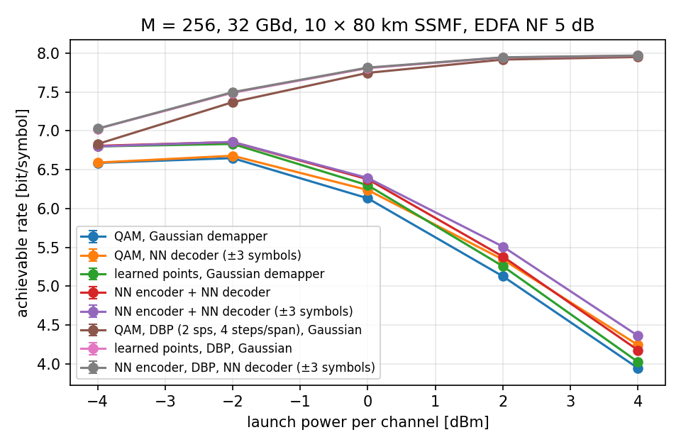
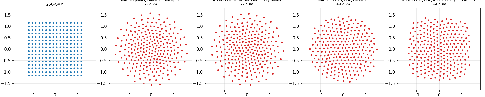

# End-to-end learning of an NN encoder and decoder through a fiber link

2026-09-30 · hpcom `dev` (after `741ea52`) · `hpcom.autodiff`

**Question.** Trained by gradient descent *through the physical channel* —
the split-step NLSE with ASE noise, simulated by `hpcom.autodiff` — how much
do a neural-network encoder (constellation) and decoder (demapper with
symbol memory) gain over QAM with the standard Gaussian demapper, and how
does that compare with digital back-propagation (DBP)?

**Answer.** At the optimal launch power a learned transmitter gains
**+0.21 bit/symbol** over 256-QAM (+0.04 over 64-QAM, which saturates near 6
bits). In the nonlinear regime a joint NN encoder + NN decoder with a
±3-symbol window gains **+0.36–0.42 bit/symbol**. Single-channel DBP is far
stronger still (+0.72 at −2 dBm, +2.8 at +2 dBm for 256 points), and
learning on top of DBP still adds up to **+0.20 bit/symbol**. The gains are
unchanged on a 5× finer simulation of the same link.

## Setup

| Item | Value |
|---|---|
| Transmitter | single carrier, single polarisation, 32 GBd, exact RRC (β = 0.1), 4 samples/symbol, 4096 symbols per block, 64 or 256 points |
| Link | 10 × 80 km SSMF (α = 0.2 dB/km, D = 17 ps/(nm·km), γ = 1.27 /W/km), EDFA NF 5 dB per span; split-step, 20 steps/span |
| Receiver | CD compensation (or DBP: 2 samples/symbol, 4 steps/span), matched filter, data-aided complex gain (genie phase recovery) |
| Rate | symbol-wise, on 16 fresh blocks shared by all methods (paired): Gaussian-channel MI of `hpcom.metrics` for the Gaussian demapper; cross-entropy bound H(X) − CE/ln 2 for NN decoders — both lower bounds on the MI for their metric |
| Training | Adam, 2000 steps, a fresh block of data *and* noise per step; lr 1e-3 (NN), 1e-2 (points); complex64 on the GPU |

Methods (`run.py`):

| Name | Transmitter | Receiver / demapper |
|---|---|---|
| `qam+gauss` | QAM | Gaussian |
| `qam+nn` | QAM | NN decoder, window ±3 symbols |
| `gs+gauss` | learned points | Gaussian |
| `ae` | NN encoder | NN decoder, memoryless |
| `ae+mem` | NN encoder | NN decoder, window ±3 symbols |
| `qam+dbp` | QAM | DBP + Gaussian (not trained) |
| `gs+dbp` | learned points | DBP + Gaussian, trained through DBP |
| `ae+mem+dbp` | NN encoder | DBP + NN decoder (±3), trained through DBP |

NN designs are model-based + learned, so training starts from the classical
system and can only learn beyond it: the encoder is QAM plus an MLP
correction of every point (one-hot → 64 → 2, ReLU); the decoder's logits are
the Gaussian metric −e^s·|z_k − x_m|² with learned scale s (initialised to
1/σ² measured on one block) plus an MLP (Re/Im of z_{k−3…k+3} and |z_k|² →
128 → 128 → M). A pure MLP decoder from random initialisation learned
slowly (3.87 bit/symbol after 100 steps, where the Gaussian demapper gives
5.79), and a fixed initial scale that did not match the noise made the first
~500 steps worse than the baseline (`pilot-1000steps/`).

## Results

Rate in bit/symbol (paired difference to the QAM + Gaussian baseline; ±
standard error). Full tables: `results-64/summary.md`,
`results-256/summary.md`.

**256 points**

| Method | −4 dBm | −2 dBm | 0 dBm | +2 dBm | +4 dBm |
|---|---|---|---|---|---|
| QAM, Gaussian | 6.588 | **6.649** | 6.132 | 5.127 | 3.943 |
| QAM, NN decoder ±3 | +0.004 | +0.031 | +0.107 | +0.216 | +0.298 |
| learned points, Gaussian | +0.212 | +0.183 | +0.168 | +0.130 | +0.081 |
| NN encoder + NN decoder | +0.220 | +0.207 | +0.246 | +0.254 | +0.232 |
| NN encoder + NN decoder ±3 | +0.213 | **+0.209** | +0.262 | +0.383 | +0.417 |
| QAM, DBP | +0.243 | +0.721 | +1.616 | +2.793 | +4.009 |
| learned points, DBP | +0.439 | +0.843 | +1.678 | +2.819 | +4.026 |
| NN encoder, DBP, NN decoder ±3 | +0.441 | +0.850 | +1.684 | +2.821 | +4.028 |

**64 points** (the rate saturates near 6 bits at the optimum)

| Method | −2 dBm (optimum) | +2 dBm | +4 dBm |
|---|---|---|---|
| QAM, Gaussian | 5.905 | 5.062 | 3.961 |
| learned points, Gaussian | +0.034 | +0.133 | +0.108 |
| NN encoder + NN decoder ±3 | +0.037 | +0.304 | +0.416 |
| QAM, DBP | +0.090 | +0.938 | +2.039 |




**Robustness** (`robustness-256/`): the trained systems evaluated on the
same link simulated with 100 steps/span instead of 20 keep every gain to
±0.001 bit/symbol (e.g. `ae+mem` at +2 dBm: +0.364 on both), so the networks
learned the physics, not artefacts of the training simulator.

## Findings

1. **Shaping gain at the optimum.** Learned points alone give most of it
   (+0.18 for 256 points: Gaussian-like disc constellations); the joint NN
   encoder + decoder adds ~0.03 more.
2. **Learned nonlinearity mitigation is partial.** The NN decoder with a
   ±3-symbol window gains +0.2–0.3 bit/symbol in the nonlinear regime even
   with QAM, and +0.36–0.42 jointly with an NN encoder; a memoryless decoder
   gains about half of that.
3. **DBP dominates for a single channel.** The nonlinearity is deterministic
   signal–signal interaction with ~110 symbols of dispersion memory; DBP
   removes it and moves the optimum beyond +4 dBm (where 256 points reach
   their 8-bit ceiling in this sweep). A ±3-symbol NN window cannot compete.
4. **Learning still helps on top of DBP** — through the differentiable DBP
   receiver: +0.20 (−4 dBm), +0.13 (−2 dBm), +0.07 (0 dBm), shrinking as DBP
   approaches the constellation ceiling. After DBP the NN decoder adds
   nothing beyond the learned points: the residual is noise-like.

## Limitations and next steps

- Single channel, single polarisation, 10 spans; a genie data-aided phase
  equaliser; symbol-wise rates (not bit-wise GMI); one training seed per
  point (evaluation is paired, training-seed variance is not assessed).
- The DBP curves hit the 256-point ceiling at high power; the DBP optimum
  needs more points or more spans.
- Where learning should matter more: **WDM**, where inter-channel
  interference from channels the receiver does not see cannot be
  back-propagated; decoders with long memory (CNN/RNN over ~100 symbols);
  learned DBP and NN decoder trained jointly; bit-wise training (BCE → GMI).

## Reproduce

```bash
# GPU environment (as benchmarks/gpu_validation.sh): UV_PROJECT_ENVIRONMENT=.venv-jax-gpu uv sync --extra dev --extra jax-cuda
python run.py --order 64  --out results-64
python run.py --order 256 --out results-256
python run.py --order 256 --methods qam+dbp gs+dbp ae+mem+dbp --append --out results-256
python run.py --order 64  --methods qam+dbp --append --out results-64
python run.py --order 256 --powers -2 2 --methods qam+gauss qam+nn gs+gauss ae+mem qam+dbp ae+mem+dbp \
              --eval-steps-per-span 100 --out robustness-256
python plot.py results-256
```

Each sweep takes ≈ 15 min on a laptop RTX 3070 (complex64; ≈ 1 min per
method and power). These runs used this workstation's GPU because the
compute node was fully booked.
