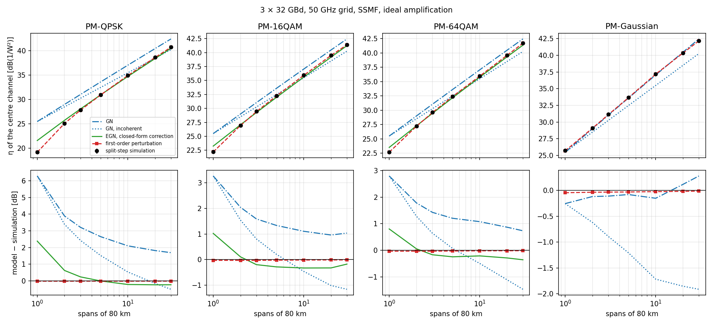

# GN, EGN and first-order NLI models against the split-step simulation

2026-10-01 · hpcom `dev` · `hpcom.nli`

**Question.** How accurate are the NLI models of `hpcom.nli` — the GN
reference formula, the closed-form EGN correction and the first-order
perturbation of the actual signal — against the noiseless split-step
simulation, for QAM and Gaussian symbols, 1 to 30 spans?

**Answer.** The **first-order perturbation equals the simulation within
0.05 dB** at every one of the 28 points. The **GN model overestimates the
NLI of QAM**: by 6.3 / 3.3 / 2.8 dB at one span (QPSK / 16-QAM / 64-QAM),
still 1.7 / 1.0 / 0.7 dB at 30 spans. The **closed-form EGN correction**
fixes most of that from three spans on (within ±0.37 dB), but is 0.8–2.4 dB
high at one span, as its authors state. For Gaussian symbols GN is within
−0.26 … +0.28 dB.

## Setup

| Item | Value |
|---|---|
| Channels | 3 × 32 GBd, dual polarisation, RRC β = 0.1, 50 GHz grid; the centre channel is scored |
| Link | 1–30 spans of 80 km SSMF (0.2 dB/km, D = 17 ps/(nm·km), γ = 1.27 /W/km), ideal noiseless EDFAs |
| Simulation | split-step, 100 steps/span (logarithmic), at the power where GN predicts SNR_NLI = 30 dB and 3 dB above; η = 1/(SNR·P²) |
| Models | `nli_coefficient` (GN coherent / incoherent, `model="egn"`), `first_order_nli` (96 nodes per span) |
| Statistics | 4 blocks of 4096 symbols; the first-order estimate and the simulation use the *same* blocks (η itself varies by up to 0.3 dB from block to block) |

The simulated η at P and P + 3 dB differ by 0.02–0.05 dB: the simulation is
in the first-order regime, and far above its own numerical noise.

## Results



η of the centre channel in dB(1/W²) (full table: `results/summary.md`):

| format | spans | GN | GN incoh. | EGN closed form | first order | SSFM |
|---|---|---|---|---|---|---|
| PM-QPSK | 1 | 25.49 | 25.49 | 21.58 | 19.18 | 19.20 |
| PM-QPSK | 5 | 33.60 | 32.48 | 30.95 | 30.94 | 30.95 |
| PM-QPSK | 30 | 42.45 | 40.26 | 40.53 | 40.75 | 40.76 |
| PM-16QAM | 1 | 25.49 | 25.49 | 23.24 | 22.19 | 22.22 |
| PM-16QAM | 5 | 33.60 | 32.48 | 31.99 | 32.25 | 32.27 |
| PM-16QAM | 30 | 42.45 | 40.26 | 41.24 | 41.40 | 41.42 |
| PM-64QAM | 1 | 25.49 | 25.49 | 23.50 | 22.67 | 22.70 |
| PM-64QAM | 5 | 33.60 | 32.48 | 32.16 | 32.38 | 32.40 |
| PM-64QAM | 30 | 42.45 | 40.26 | 41.36 | 41.70 | 41.72 |
| PM-Gaussian | 1 | 25.49 | 25.49 | — | 25.70 | 25.74 |
| PM-Gaussian | 5 | 33.60 | 32.48 | — | 33.65 | 33.68 |
| PM-Gaussian | 30 | 42.45 | 40.26 | — | 42.16 | 42.17 |

## Findings

1. **First order is the whole story here.** At the powers that matter
   (SNR_NLI ≈ 30 dB, near the optimum) the first-order field reproduces the
   simulated NLI to 0.05 dB, for every format and length.
2. **GN is pessimistic for QAM**, most at few spans and for QPSK — the
   modulation's fourth moment (Φ = 1, 17/25, 13/21) sets the size. Only for
   Gaussian symbols does GN describe the signal.
3. **Coherence matters.** The incoherent GN model under-counts long links
   (−1.9 dB vs the simulation at 30 spans, Gaussian symbols). For QAM it
   looks close around 5–10 spans only because that under-count cancels GN's
   overestimate.
4. **The closed-form EGN** is a good engineering formula beyond a few spans
   (|error| ≤ 0.37 dB from 3 spans on), not at one or two spans.
5. **An open residual:** for Gaussian symbols GN reads 0.08–0.26 dB low at
   1–10 spans (−0.15 ± 0.02 dB at 10). GN treats the signal as stationary
   noise; RRC-shaped symbols are cyclostationary and are sampled once per
   symbol. The first-order estimate, which makes neither approximation,
   agrees with the simulation.

Cross-check with the literature (`tests/numerical/test_nli.py`): the GN
integral reproduces the published GN curve of Poggiolini et al. 2015
(arXiv:1503.04132, Fig. 1a) at 1 and 50 spans, and the closed-form EGN their
50-span value.

## Reproduce

```bash
python run.py --out results     # job.sh on bugatti: CPU, 4 cores, 7 min
python plot.py results
```
