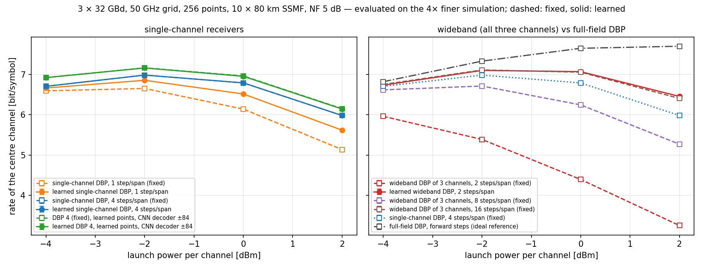

# Learned DBP and long-memory decoders, trained end to end through a WDM link

2026-10-01 · hpcom `dev` (after `533d2aa`) · `hpcom.autodiff.learned_dbp`

**Question.** The WDM study (`research/2026-10-01-nn-wdm`) left 0.55
bit/symbol between the best learned system (single-channel DBP, learned
points) and ideal full-field DBP. Can a *learned* DBP — every step's filter,
Kerr coefficient and power filter trainable — or a decoder with memory as
long as the neighbours' walk-off close part of it?

**Answer.** Learned DBP pays off where fixed DBP is short of steps: a
**learned wideband DBP of all three channels with 2 steps/span equals fixed
wideband DBP with 16 steps/span** (7.10 vs 7.12 bit/symbol at −2 dBm, 6.46
vs 6.41 at +2 dBm) — 8× fewer steps, +1.7 bit/symbol over the fixed 2-step
version at −2 dBm. It beats single-channel DBP by +0.12 bit/symbol at the
optimum (+0.28 at 0 dBm, a third of the gap to ideal full-field DBP there).
Single-channel learned DBP at 1 step/span recovers ~60 % of what one step
loses against four; at 4 steps/span it has nothing left to learn. A decoder
with ±84 symbols of memory adds only ~0.02 bit/symbol over learned points
alone: the neighbours' interference is not predictable from the centre
channel's own symbols.

## Results

Rate of the centre channel on the 4× finer simulation, bit/symbol (paired
gain over fixed single-channel DBP with 4 steps/span ± standard error;
both tables: `results/summary.md`).

| receiver | −4 dBm | −2 dBm | 0 dBm | +2 dBm |
|---|---|---|---|---|
| single-channel DBP, 4 steps/span (fixed) | 6.709 | **6.988** | 6.793 | 5.984 |
| single-channel DBP, 1 step/span (fixed) | −0.112 | −0.333 | −0.651 | −0.848 |
| learned single-channel DBP, 1 step/span | −0.042 | −0.129 | −0.275 | −0.366 |
| learned single-channel DBP, 4 steps/span | −0.000 | +0.000 | +0.002 | −0.000 |
| DBP 4 (fixed) + learned points + CNN decoder ±84 | +0.217 | +0.181 | +0.173 | +0.169 |
| learned DBP 4 + learned points + CNN decoder ±84 | +0.216 | +0.177 | +0.165 | +0.161 |
| wideband DBP, 2 steps/span (fixed) | −0.747 | −1.601 | −2.402 | −2.738 |
| wideband DBP, 4 steps/span (fixed) | −0.370 | −0.941 | −1.576 | −1.885 |
| wideband DBP, 8 steps/span (fixed) | −0.089 | −0.272 | −0.546 | −0.715 |
| wideband DBP, 16 steps/span (fixed) | +0.046 | **+0.127** | +0.268 | +0.425 |
| **learned wideband DBP, 2 steps/span** | +0.028 | **+0.116** | +0.281 | +0.474 |
| full-field DBP, 30 forward steps/span (ideal) | +0.115 | +0.348 | +0.862 | **+1.723** |



## Findings

1. **Wideband DBP needs many steps, or learning.** Fixed DBP of a 150 GHz
   band at 2–8 steps/span is *worse* than single-channel DBP: the channels
   walk off within a long step and the step's power beating (at 50 and
   100 GHz) is wrong. Learned at 2 steps/span it matches the fixed version
   at 16. What it learned (`results/results.json`): a broad low-pass power
   filter in every Kerr step (off-centre taps 3.6–4.1× the centre tap),
   an overall ξ ≈ 0.77, and dispersion-filter corrections up to 0.4 rad —
   filtered DBP, found by gradient descent.
2. **Single-channel learned DBP compresses steps.** At 1 step/span it
   recovers 0.20–0.48 bit/symbol of the 0.33–0.85 that one step loses
   against four (−2…+2 dBm), with the same low-pass power filter and
   ξ ≈ 0.84–0.86. At 4 steps/span its parameters barely move (ξ = 1.003,
   power filters within 12 % of identity) and neither does the rate: the
   remaining impairment is the neighbours' XPM and the ASE, which
   single-channel DBP cannot reach.
3. **Long memory does not help a single-channel receiver.** The CNN
   decoder (receptive field 169 symbols) on top of DBP and learned points
   adds +0.015–0.022 bit/symbol over learned points alone
   (`research/2026-10-01-nn-wdm`, same data and noise). The neighbours'
   symbols are independent of the centre channel's: their XPM is noise to
   anything that sees only the centre channel.
4. **Joint training changes nothing at 4 steps/span**: learned DBP + points
   + CNN equals fixed DBP + points + CNN (±0.01).
5. **Training needs averaging.** Constant-rate Adam let learned DBP drift on
   noisy gradients (−0.03 bit/symbol at −4 dBm in the first run); cosine
   decay and a Polyak average remove it (learned 4-step DBP within ±0.002
   of its start at every power).

## Next

- Learned wideband DBP with 4–8 steps/span and learned points: how close to
  the 7.7 bit/symbol of full-field DBP can a multi-channel receiver get?
- More channels (5–9) and wideband DBP of a sub-band (the neighbours'
  neighbours unseen).
- Complexity: learned FIR filters in the time domain (Häger–Pfister) instead
  of frequency-domain corrections; pruning.

## What is learned, block by block

The chain is that of the WDM study; blocks 5 and 8 change.

| # | Block | Fixed or learned |
|---|---|---|
| 1–3 | symbols, encoder, RRC shaping, 3 channels on a 50 GHz grid | QAM, or **learned points** (`gs`) |
| 4 | 10 × 80 km SSMF + EDFA (NF 5 dB), split-step NLSE of the whole field | fixed physics |
| 5 | DBP | **fixed** (`dbp`, `wdbp`, `ffdbp`) or **learned** (`ldbp`, `wldbp`) |
| 6–7 | channel selection, matched filter, data-aided complex gain | fixed |
| 8 | demapper | Gaussian metric, or Gaussian metric + **dilated CNN** over ±84 symbols (`cnn`) |

**Learned DBP** (`hpcom.autodiff.learned_dbp`). DBP runs the split-step
solution backwards: linear steps (dispersion, loss, amplifier gains of the
receiver's link model) alternate with Kerr steps, a phase κ_j·P. The learned
version starts *exactly* as that DBP and trains, per step:

- the linear filter: a phase and a gain correction, piecewise linear on 33
  frequency knots (smooth in frequency: corrections of the dispersion and
  filtering per step);
- the Kerr coefficient κ_j and one global scale ξ;
- a 17-tap real filter on the power before the Kerr phase — the
  filtered/enhanced split step, which lets a long step act on a low-passed
  power (walk-off within the step).

Single-channel learned DBP (`ldbp1`, `ldbp4`) sees only the centre channel,
low-passed to 1.1·Rs at 2 samples/symbol, as a real single-channel receiver.
The wideband version (`wldbp2`) sees all three channels at the simulation
rate — a receiver that digitises the whole band — and starts from wideband
DBP with 2 steps/span.

**Long-memory decoder.** The neighbours walk off by ≈17 symbols per span
(≈174 over the link). Three dilated convolutions (kernel 9, dilations 1, 4,
16; 32 channels) over (Re z, Im z, |z|²) give a receptive field of 169
symbols; a 32 → 128 → 256 head adds its logits to the Gaussian metric
−e^s|z − x_m|², whose scale starts at the measured 1/σ².

**Training.** Adam, 2000 steps, a fresh block of data and noise per step,
gradients through the whole chain including the split-step simulation;
learning rates 1e-3 (DBP, CNN), 1e-2 (points), with cosine decay to 0.
Evaluation uses the Polyak average (EMA 0.99) of the iterates. A first run
without decay and averaging let the learned DBP random-walk on noisy
gradients and end 0.03 bit/symbol *below* the DBP it started from at
−4 dBm; with them learned 4-step DBP stays within ±0.002 bit/symbol of its
start (finding 5).

## Reproduce

```bash
# GPU environment: UV_PROJECT_ENVIRONMENT=.venv-jax-gpu uv sync --extra dev --extra jax-cuda
python run.py --cosine --ema 0.99 --out results                                   # job.sh
python run.py --cosine --ema 0.99 --methods dbp1 wdbp2 wdbp8 wdbp16 --append --out results  # job-baselines.sh
python plot.py results
```
