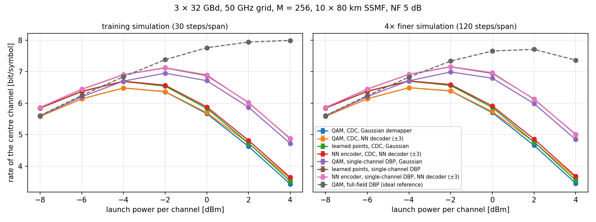
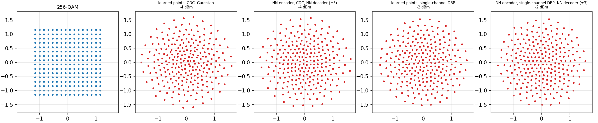

# End-to-end learning over a WDM link: what a receiver can learn about its neighbours

2026-10-01 · hpcom `dev` (after `51eb125`) · `hpcom.autodiff`

**Question.** With three WDM channels, the centre channel suffers
inter-channel nonlinearity (XPM, FWM) from neighbours its receiver does not
see. How much do a learned constellation, an NN encoder and an NN decoder
gain then — with CD compensation or with single-channel DBP in front — and
how far is that from back-propagating the whole field?

**Answer.** Learned points give the same shaping gain as for one channel,
**+0.21 bit/symbol** at the CDC optimum (−4 dBm). The NN decoder with a
±3-symbol window gains nothing up to −2 dBm and +0.1–0.18 bit/symbol above.
**Single-channel DBP is still the largest gain**: it moves the optimum to −2 dBm
and +0.50 bit/symbol over the CDC optimum (6.99 vs 6.49 bit/symbol). Learned
points on top of DBP add +0.16, an NN decoder after DBP another +0.01. Ideal
full-field DBP (all three channels known) reaches 7.71 bit/symbol: the
remaining **0.55 bit/symbol** is the inter-channel interference that the
single-channel receiver cannot undo, and none of the learned blocks touch it.

## The experiment, step by step

Every method runs the same chain; only the blocks marked **learned** have
trainable parameters. Gradients of the rate flow back through *every* block,
including the split-step simulation of the fiber (`hpcom.autodiff`).

| # | Block | Fixed or learned | What it does |
|---|---|---|---|
| 1 | symbol source | fixed | uniform indices 0…255, independent for each of the 3 channels |
| 2 | **encoder** | **learned** (`gs`, `ae`) | index → complex point. `qam`: 256-QAM. `gs`: 256 free points (512 real numbers). `ae`: 256-QAM plus an MLP correction (one-hot → 64 → 2). Normalised to unit mean power. All three channels use the same encoder. |
| 3 | pulse shaping, WDM | fixed | RRC (β = 0.1), 32 GBd, channels at −50, 0, +50 GHz, single polarisation, 5 samples/symbol of the composite field, launch power per channel |
| 4 | fiber link | fixed physics | 10 × 80 km SSMF, split-step NLSE of the whole 3-channel field (30 steps/span, logarithmic), EDFA with NF 5 dB adding ASE after each span |
| 5a | CD compensation | fixed | exact inverse of the link's β₂L on the whole field (frequency domain) — `qam+gauss`, `qam+nn`, `gs+gauss`, `ae+mem` |
| 5b | single-channel DBP | fixed (not learned) | low-pass to 1.1·Rs around the centre channel, 2 samples/symbol, back-propagate with 4 steps/span — what a real receiver can do: the neighbours are filtered out, so their XPM/FWM stays — `*+dbp` |
| 5c | full-field DBP | fixed, ideal | back-propagate all three channels at the simulation rate with the forward steps — needs the neighbours' fields: a reference, not a receiver — `qam+ffdbp` |
| 6 | channel selection, matched filter | fixed | centre channel to 0 Hz, RRC matched filter, symbol-rate sampling |
| 7 | complex gain | fixed (data-aided) | one least-squares complex number per 2048-symbol block (genie mean phase and amplitude) |
| 8 | **decoder** | **learned** (`qam+nn`, `ae`) | logits = −e^s·\|z_k − x_m\|² + MLP(Re/Im z_{k−3…k+3}, \|z_k\|²) → 128 → 128 → 256; the scale s starts at the measured 1/σ², so training starts at the Gaussian demapper |
| 9 | rate | — | Gaussian demapper: the MI estimator of `hpcom.metrics`; NN decoder: H(X) − CE/ln 2 (a lower bound on the MI) |

**CD compensation comes before the NN in every method** — it costs nothing in
a real receiver, and it is block 5, ahead of the matched filter and of the
decoder. The decoder sees CD-compensated, matched-filtered symbols with the
mean phase removed; it is never asked to learn dispersion. DBP (5b) is the
classical physics-based stage with the link's own parameters; nothing in it
is trained here (learned DBP is the next experiment).

Training: Adam, 2000 steps, a fresh block of data and noise (2048 symbols)
per step, learning rate 1e-2 for free points, 1e-3 for MLPs; complex64 on the
GPU. Evaluation: 16 fresh blocks shared by all methods (paired differences),
on the training simulation and on a 4× finer one (120 steps/span).

**Sampling note (2026-10-04).** This study sampled the WDM field at 5
samples/symbol. Kerr products of the 135 GHz band reach ±203 GHz, and
at 160 GHz they alias into the scored centre channel. Measured on the same
kind of system: η is 0.2–0.6 dB too high at 5 samples/symbol (3 channels,
first-order model, 1–10 spans), and 64-QAM loses 0.08 bit/4D at
8 samples/symbol (5 channels, `jovanovic2023`). So the absolute rates here
are biased low. Full-field DBP cannot invert aliased products, so its
ceiling may be understated too. All methods share the same grid, so
differences between methods are probably less affected; they were not
re-measured. Alias-free: sampling rate ≥ 1.5 B + B_channel/2 for the centre
channel (`hpcom.bench` requires ≥ 2 B).

## Results

Rate of the centre channel in bit/symbol on the 4× finer simulation (paired
gain over QAM + CDC ± standard error). Both tables: `results-256/summary.md`.

| method | −8 dBm | −6 dBm | −4 dBm | −2 dBm | 0 dBm | +2 dBm | +4 dBm |
|---|---|---|---|---|---|---|---|
| QAM, CDC, Gaussian | 5.579 | 6.137 | **6.490** | 6.385 | 5.696 | 4.659 | 3.453 |
| QAM, CDC, NN decoder ±3 | +0.000 | +0.000 | +0.000 | +0.007 | +0.032 | +0.107 | +0.176 |
| learned points, CDC | +0.261 | +0.232 | +0.207 | +0.176 | +0.166 | +0.109 | +0.090 |
| NN encoder, CDC, NN decoder ±3 | +0.262 | +0.239 | **+0.216** | +0.206 | +0.215 | +0.198 | +0.223 |
| QAM, single-channel DBP | +0.016 | +0.069 | +0.219 | **+0.603** | +1.096 | +1.325 | +1.391 |
| learned points, single-channel DBP | +0.278 | +0.305 | +0.421 | **+0.766** | +1.249 | +1.472 | +1.550 |
| NN encoder, single-ch. DBP, NN decoder ±3 | +0.284 | +0.310 | +0.427 | **+0.774** | +1.272 | +1.461 | +1.564 |
| QAM, full-field DBP (ideal) | +0.024 | +0.101 | +0.334 | +0.951 | +1.959 | **+3.048** | +3.911 |




## Findings

1. **WDM moves the optimum down.** QAM + CDC peaks between −4 and −2 dBm at
   6.49 bit/symbol (one channel: −2 dBm, 6.65). The first-order NLI model
   (`hpcom.nli.first_order_nli`) predicts −3.2 dBm for this system.
2. **Shaping gain is unchanged**: +0.21 bit/symbol at the optimum, with
   Gaussian-like disc constellations (figure), as for one channel.
3. **A short-memory decoder learns little.** The ±3-symbol NN decoder gains
   nothing up to −2 dBm, and at +2…+4 dBm half of what it gained for one
   channel (+0.11–0.18 vs +0.22–0.30). The neighbours walk off by
   D·Δλ·L ≈ 544 ps ≈ 17 symbols per span (174 over the link). Their XPM
   reaching the centre channel is a sum over ~170 neighbour symbols the
   receiver never sees: to a ±3 window it looks like noise.
4. **Single-channel DBP still dominates**: +0.50 bit/symbol at the optimum
   (6.99 at −2 dBm) and +1.1–1.4 above. It removes the centre channel's own
   SPM, which the CDC receiver leaves; the neighbours' interference stays.
5. **Learning on top of DBP**: learned points +0.16 at the DBP optimum, the
   NN decoder another +0.01 — after DBP the residual is the neighbours',
   noise-like to this decoder.
6. **The gap to full-field DBP is the target**: 7.71 (ideal, +2 dBm) vs 7.16
   (best learned system, −2 dBm), 0.55 bit/symbol of inter-channel
   interference.
7. **The training simulation is accurate enough for learning.** The gains of
   the learned blocks (over the same front end) are the same on the 4× finer
   simulation to ±0.01 bit/symbol. Absolute rates there are 0.01–0.13 higher
   (coarse steps add a little numerical noise), and DBP gains up to 0.10 more
   at high power. Full-field DBP with the forward steps exactly inverts the
   training simulation, so it is quoted on the finer one, which it does not
   invert exactly.

## What could improve it (next experiments)

- **Learned DBP** — per-step trainable filters and nonlinear coefficients
  (Häger & Pfister), trained jointly with the encoder and decoder: it can
  learn more than the link's own parameters, e.g. an XPM-aware nonlinear step
  driven by a low-pass-filtered power.
- **Long-memory decoders** — CNN or RNN over ~200 symbols, the XPM walk-off
  of the link.
- **A realistic phase recovery** (blind CPR) instead of the genie
  block-constant gain. CPR removes part of the slowly varying XPM phase that
  the NN decoder now competes for.
- **Dual polarisation** (Manakov; supported by `hpcom.autodiff`, not used here).
- **Bit-wise training** (BCE → GMI); several seeds per point (training
  variance is not assessed); more channels (here only two neighbours).

## Reproduce

```bash
# GPU environment: UV_PROJECT_ENVIRONMENT=.venv-jax-gpu uv sync --extra dev --extra jax-cuda
python run.py --order 256 --out results-256                                 # job.sh
python run.py --order 256 --powers -8 -6 --append --out results-256         # job-low.sh
python plot.py results-256
```

Both jobs ran on bugatti's RTX 3070 (`nodes run bugatti … job.sh`, 36 min;
`job-low.sh`, 15 min); ≈1 min per learned method and power.
