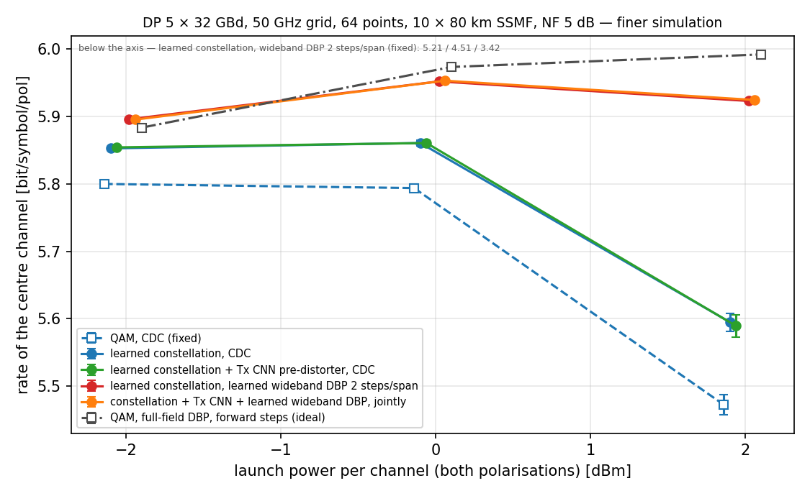

# End-to-end learning through a dual-polarisation 5-channel WDM link

2026-10-03 · hpcom `dev` · `hpcom.autodiff` (reversible adjoint)

**Question.** In a realistic dual-polarisation WDM system with lumped EDFA
spans, what does learning by gradient descent *through the split-step
simulation* buy: a learned constellation (the published state of the art,
Jovanovic et al., JLT 2023: +0.21 bit/4D for DP 5 × 32 GBd, 64 points,
10 × 100 km), a transmitter *with memory*, a learned wideband DBP, or all
of them trained jointly?

## Setup

| Item | Value |
|---|---|
| Transmitter | 5 × 32 GBd on a 50 GHz grid, dual polarisation, RRC β = 0.1, 8 samples/symbol of the composite field, 2048 symbols/block, 64 points (one constellation for all channels and polarisations) |
| Link | 10 × 80 km SSMF (Manakov), EDFA NF 5 dB after every span; split-step 50 steps/span (logarithmic, k = 1/3) for training, 200 for evaluation |
| Receiver | centre channel: CD compensation or DBP, matched filter, data-aided complex gain per polarisation, Gaussian demapper |
| Rate | Gaussian-demapper MI per polarisation, averaged over the two (bit/symbol/pol; ×2 for bit/4D), on 16 paired blocks |
| Training | Adam, 2000 steps, fresh data and noise per step, cosine decay, Polyak average (0.99); gradients through the whole field's split-step simulation by the **reversible adjoint** (memory independent of the 500 steps) |

## What is learned where

| Method | Transmitter | Receiver front end |
|---|---|---|
| `qam+cdc` | 64-QAM | CD compensation |
| `gs+cdc` | **learned constellation** | CD compensation |
| `gs+txcnn+cdc` | **learned constellation + residual dilated-CNN pre-distorter** on each channel's symbols (both polarisations, receptive field 169 symbols; starts at identity) | CD compensation |
| `gs+wdbp2` | learned constellation | wideband DBP of all 5 channels, 2 steps/span (fixed) |
| `gs+wldbp2` | learned constellation | **learned** wideband DBP, 2 steps/span (`ad.learned_dbp`) |
| `gs+txcnn+wldbp2` | learned constellation + pre-distorter | learned wideband DBP — all trained jointly |
| `ffdbp` | 64-QAM | full-field DBP with the forward steps (ideal reference) |

The pre-distorter's output is renormalised to unit mean power per channel;
the receiver decodes the constellation points.

**Answer.** The **learned wideband DBP** carries the gain: with the learned
constellation it adds **+0.18 bit/4D at the optimum** over the learned
constellation behind CDC (5.95 vs 5.86 bit/symbol/pol), within 0.02
bit/symbol/pol of ideal full-field DBP at 0 dBm (5.95 vs 5.97), where fixed wideband DBP
with the same 2 steps/span collapses (4.51). The learned constellation gains
+0.12 bit/4D over 64-QAM at the respective optima. The **transmitter with
memory** (CNN pre-distorter) gains **nothing** — alone or trained jointly
with the learned DBP (±0.01). Caveat: 64 points cap the rate at 6
bit/symbol/pol and ideal DBP reaches 5.99, so every gain near the optimum is
compressed by the ceiling.

## Results

Rate of the centre channel on the 4× finer simulation (200 steps/span),
bit/symbol/pol, averaged over both polarisations (×2 for bit/4D); paired gain
over 64-QAM + CDC ± standard error. Both tables (training and finer
simulation): `results/summary.md`.

| method | −2 dBm | 0 dBm | +2 dBm |
|---|---|---|---|
| 64-QAM, CDC | **5.800** | 5.794 | 5.473 |
| learned constellation, CDC | +0.053 | **+0.067** | +0.122 |
| learned constellation + Tx CNN pre-distorter, CDC | +0.054 | +0.067 | +0.117 |
| learned constellation, wideband DBP 2 steps/span (fixed) | −0.586 | −1.283 | −2.054 |
| learned constellation, **learned** wideband DBP 2 steps/span | +0.096 | **+0.158** | +0.450 |
| all jointly (constellation + Tx CNN + learned wideband DBP) | +0.095 | +0.159 | +0.452 |
| 64-QAM, full-field DBP, forward steps (ideal) | +0.083 | +0.179 | **+0.519** |



Training cost: 2–4 minutes per method and power on bugatti's RTX 3070 —
2000 Adam steps, each a forward and reversible-adjoint backward pass through
500 split steps of the 5-channel dual-polarisation field (2 × 16384
samples), with memory independent of the step count.

## Findings

1. **Learned constellation**: +0.06 bit/symbol/pol (+0.12 bit/4D) over 64-QAM
   at the respective optima (5.860 vs 5.800). Jovanovic et al. report +0.21
   bit/4D for a similar system at 1000 km; here the shorter link and the
   64-point ceiling leave less room.
2. **Learned wideband DBP at 2 steps/span**: +0.09 bit/symbol/pol over the
   learned constellation behind CDC at the optima (5.952 vs 5.860), and
   +1.44 bit/symbol/pol over the fixed DBP with the same steps at 0 dBm.
   With dual polarisation and five channels it again turns a DBP far too
   coarse to work into one close to ideal.
3. **A transmitter with memory learns nothing here.** The CNN pre-distorter
   (receptive field 169 symbols) starts at identity and ends there in
   effect: ±0.006 bit/symbol/pol behind CDC, +0.001 jointly with learned
   DBP. Pre-distorting one channel's own symbols cannot reach the
   neighbours' XPM, and the receiver-side DBP already removes the channel's
   own SPM. (In Uhlemann's thesis the gain over per-sub-carrier DBP came
   from a pre-distorter fed with *all* sub-carriers' symbols.)
4. **Joint training adds nothing** over training the receiver-side DBP with
   the constellation.

## Next

- Lift the ceiling: 256 points or 20 spans, so that the gains are not
  compressed.
- A transmitter that sees all channels (joint pre-distortion of the WDM
  field) — the transmitter-side counterpart of wideband DBP.

## Reproduce

```bash
# GPU environment: UV_PROJECT_ENVIRONMENT=.venv-jax-gpu uv sync --extra dev --extra jax-cuda
python run.py --cosine --ema 0.99 --out results   # job.sh
python plot.py results
```
