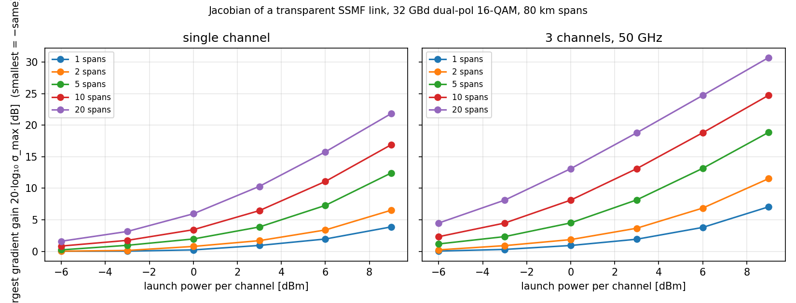

# Do gradients explode through a fiber link?

2026-10-03 · hpcom `dev` (after `141dbb8`) · `hpcom.autodiff.jacobian_singular_values`

**Question.** End-to-end learning papers avoid gradients through the
split-step simulation partly because back-propagation through it "is prone to
uncontrolled growth or vanishing of gradients" — asserted, never measured.
How large are the gradient gains of a real link?

**Answer.** Moderate, and set by the physics, not by the number of steps.
At the optimum launch power the largest gradient gain of a transparent SSMF
link is **2–6 dB for one channel (5–20 spans) and 4–12 dB for three
channels**. It grows with power and length — 31 dB for three channels over
20 spans at +9 dBm, far above the optimum — and the link is symplectic, so
the smallest gain is exactly the reciprocal. Gradients neither vanish nor
explode from depth: a linear link of any length has every gain equal to 1.

## What is measured

The Jacobian J of the noiseless link (EDFAs restore the launch power), from
the transmitted field to the received one, at an actual 16-QAM signal
(RRC β = 0.1, 32 GBd, dual polarisation, 1024 symbols). Its singular values
are the gains of input perturbations (‖Jδ‖/‖δ‖) and of gradients flowing back
to the transmitter (‖Jᵀg‖/‖g‖); the top 8 are computed by subspace iteration
with forward- and reverse-mode products (30 iterations, complex128;
`tests/numerical/test_sensitivity.py` checks it against the full SVD).
Links: 1–20 spans of 80 km SSMF, 50 steps/span (logarithmic); one channel,
or three on a 50 GHz grid.

**Structure.** Every split step is symplectic (Kerr step: exact flow of a
Hamiltonian; dispersion: unitary); loss and gain only scale. A transparent
link is symplectic, so its singular values pair up, σᵢ·σ₂ₙ₊₁₋ᵢ = 1 (verified
to 1e-10): if one direction amplifies gradients by σ_max, another shrinks
them by exactly 1/σ_max.

## Results



Largest gain 20·log₁₀ σ_max in dB (`results/summary.md`):

| system | spans | −6 dBm | −3 | 0 | +3 | +6 | +9 dBm |
|---|---|---|---|---|---|---|---|
| 1 channel | 1 | 0.00 | 0.02 | 0.22 | 0.93 | 1.95 | 3.87 |
| 1 channel | 5 | 0.23 | 0.95 | 1.95 | 3.86 | 7.28 | 12.43 |
| 1 channel | 10 | 0.83 | 1.73 | 3.42 | 6.45 | 11.08 | 16.91 |
| 1 channel | 20 | 1.60 | 3.15 | 5.95 | 10.30 | 15.77 | 21.85 |
| 3 channels | 1 | 0.04 | 0.30 | 0.92 | 1.91 | 3.79 | 7.06 |
| 3 channels | 5 | 1.17 | 2.33 | 4.50 | 8.15 | 13.15 | 18.87 |
| 3 channels | 10 | 2.32 | 4.48 | 8.11 | 13.10 | 18.80 | 24.75 |
| 3 channels | 20 | 4.48 | 8.11 | 13.10 | 18.79 | 24.72 | 30.73 |

At the optimum launch power (first-order NLI model with EDFA NF 5 dB,
`hpcom.nli`):

| system | spans | P_opt | SNR_opt | largest gradient gain at P_opt |
|---|---|---|---|---|
| 1 channel | 5 / 10 / 20 | +0.4 / 0.0 / −0.2 dBm | 24.6 / 21.2 / 17.9 dB | 2.2 / 3.5 / 5.8 dB |
| 3 channels | 5 / 10 / 20 | −0.4 / −0.7 / −0.8 dBm | 23.8 / 20.5 / 17.3 dB | 4.2 / 7.3 / 11.8 dB |

## Findings

1. **No explosion where systems operate.** Near the optimum the gains stay
   within ±12 dB: a condition number of at most ~16 in amplitude, which Adam
   (per-parameter normalised steps) absorbs easily. Our end-to-end runs
   through 300–500 split steps trained without gradient clipping or
   rescaling.
2. **The physics sets the gain.** Every gain is 1 for a linear link of any
   length; nonlinearity spreads them, more with power, length and
   neighbours (inter-channel interference doubles the gain in dB).
3. **For WDM the gain depends on N·P**, the accumulated nonlinear phase: the
   value at N spans and power P equals that at 2N spans and P − 3 dB within
   1 % (three channels, 5→10→20 spans); within 3 % for one channel.
4. **Exploding and vanishing come together.** Symplecticity ties the
   smallest gain to the largest, so the ratio between the most and least
   amplified gradient directions is σ_max², e.g. 24 dB at P_opt for three
   channels over 20 spans.
5. **Where the trouble really is.** The training difficulties reported in
   the literature (convergence failures at 10 dBm, the need to ramp γ up
   from 0; Uhlemann et al. 2020, 2022) appeared at high launch powers. In
   our systems σ_max reaches 15–30 dB there, far above its value at the
   optimum — consistent with a physical cause, not with back-propagation
   through many steps.

## Limits

Top 8 singular values only (at +9 dBm σ₈ is 20–60 % below σ₁: many
directions are amplified, not one); noiseless link (ASE adds, it does not
change J); PMD and Raman not included; one 1024-symbol block per point.
The 3-channel field was sampled at 5 samples/symbol, below the alias-free
rate (Kerr products of the 135 GHz band reach ±203 GHz; 160 GHz sampling).
Aliased products raise the first-order NLI by 0.2–0.6 dB there, so the
3-channel singular values may be slightly too large. They were not
re-measured (note added 2026-10-04).

## Reproduce

```bash
python run.py --out results     # job.sh on bugatti: GPU, 10 min
python plot.py results
```
