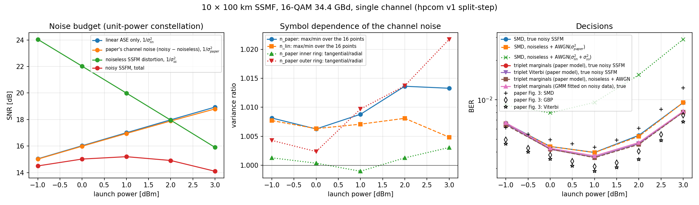
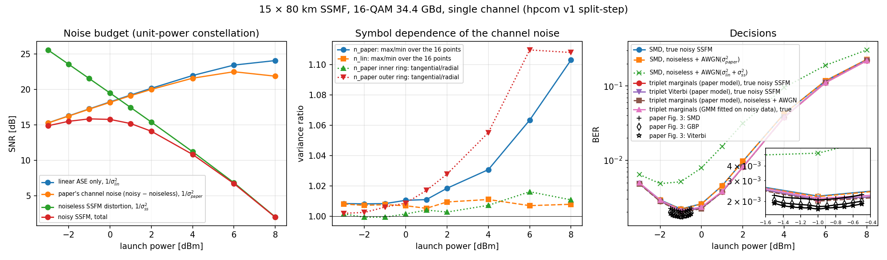

# Noise model and triplet decoding of Alves et al. (JLT-40902-2026) against the split-step simulation

2026-10-28 · hpcom `dev` (after `0b698b9`) · bugatti (RTX 3070, JAX backend)

**Question.** Reviewer 1, point 1: "*The effect of noise is added in the form of
power-dependent Gaussian to the noiseless ISI model* — does the noise variance
depend on the symbols? It should have a fixed variance given by the OSNR." A
co-author's follow-up: adding a power-dependent Gaussian term is right for
GN/EGN link models but would count nonlinearity twice on top of a split-step
simulation. What did the paper actually do, is it correct, and does the
decoder gain survive on the true noisy split-step output?

**Answer.**

1. *No double counting.* The paper's pipeline
   (`~/triplet-fitting/legacy/data_collection_pilot_and_channel_noise.py`)
   propagates every waveform twice, with ASE injected at every EDFA inside the
   split-step loop and without, and takes one Gaussian variance per launch
   power from the difference of the two received symbol streams (each scaled
   by its own data-aided gain, `nonlinear_shift`). Signal–signal nonlinearity
   is common to both runs and cancels; the difference is the linear ASE plus
   its nonlinear interaction with the signal. Measured: σ²_noise / σ²_lin =
   1.004 – 1.036 from the linear regime to 2 dB above the optimum. A GN-type
   term added on top (what the co-author feared) would more than double the
   BER at the optimum (column "σ²_lin + σ²_ss" below); the paper does not do
   that.
2. *The noise is i.i.d. and fixed by the OSNR.* One variance per launch power,
   the same for every symbol; it scales as 1/P only because the received
   constellation is normalised to unit power (SNR_lin = P + 16.0 dB for 10 × 100 km,
   P + 18.3 dB for 15 × 80 km, slope 1 dB/dB). Up to +3 dBm (+2 dBm for
   15 × 80 km) the actual split-step noise conditioned on the transmitted point
   varies by ≤ 1.8 % over the 16 points (the estimator floor for pure ASE is
   0.5–0.9 %), outer-ring tangential/radial ≤ 1.03, |excess kurtosis| ≤ 0.012,
   adjacent-symbol correlation ≤ 0.004, and it is uncorrelated with the
   deterministic distortion (|ρ| < 1e-3). Beyond the optimum signal–ASE
   interaction grows (15 × 80 km at +6/+8 dBm: σ²_noise = 1.24/1.66 σ²_lin,
   per-point spread 6/10 %), but the deterministic distortion then dominates.
   Decoding the noiseless output plus that Gaussian noise gives the BER of the
   true noisy output within 3 % at every power, for SMD and for the triplet
   decoder, and a triplet model fitted directly on the noisy data does no better.
3. *The decoder gains of the paper do not reproduce.* The exact posterior of
   the paper's own triplet model (forward–backward on pair states — the fixed
   point GBP converges to on an open chain) and the exact most probable
   sequence (Viterbi on the same trellis — same BER within 0.3 % near the
   optimum) reduce the BER of SMD by 1.5 – 15 % on 10 × 100 km (−1 … +3 dBm);
   the paper reports 19 – 38 % (GBP) and 24 – 45 % (Viterbi). On 15 × 80 km at
   −1 dBm: 7.0 % against the paper's 12 % and 16 %. The limit is physical:
   after CD compensation the nearest neighbours explain only 4–5 % of the
   deterministic distortion variance, ±5 symbols 27 %, ±20 symbols 57 %. The
   legacy dataset of the paper has the same structure (hpcom reproduces its
   SNRs within 0.4 dB), so the difference lies in the paper's decoders or their
   test data, not in the channel.

## What is computed

`run.py` — paired runs per launch power, 64 runs × 65 536 symbols:
single-polarisation 16-QAM, 34.4 GBd, RRC β = 0.1, 16 samples/symbol; SSMF
α = 0.2 dB/km, D = 16.8 ps/(nm·km), γ = 1.2 /(W·km), 1 km steps; EDFAs restore
the span loss. Three links share the transmitted data and, for the two noisy
ones, the ASE samples: noisy (ASE at every EDFA), noiseless, and linear (γ = 0,
from a zero input: the ASE alone). The legacy scalar model injected
2hν(G−1)F per sample, 6 dB above v1's n_sp·hν(G−1); its NF = 4.5 dB is
`noise_figure_db = 10.52` here. Receiver: CD compensation, matched filter,
symbol sampling, complex data-aided gain (the paper's NPE).

`analyse.py` — per power (56 runs train, 8 test): noise budget, noise shape
per ring and per constellation point, symbol-to-symbol correlation; SMD on
A (true noisy output), B (noiseless + AWGN of the paper's variance),
C (noiseless + linear-ASE AWGN), D (noiseless + AWGN of σ²_lin + σ²_ss: the
distortion counted twice); triplet decoders with per-triplet 2-component GMMs
(EM) fitted on the noiseless training data and σ²I added (the paper's model),
by marginals and by Viterbi, plus a GMM fitted on the noisy data (oracle) and
a single Gaussian. `summary.py` tabulates, `plot.py` draws (with the paper's
Fig. 3 points from `paper/`).

`memory.py` — fraction of the noiseless distortion explained by the triplet
conditional mean and by first-order perturbation terms over ±M symbols, and the
BER after a genie subtracts it. `legacy_check.py` — the same structure on the
paper's legacy test file. `decoder_check.py` — the decoders on synthetic ISI
confined to the triplet (they recover the ISI-free BER).

## Results: 10 × 100 km (Fig. 3 top of the paper)



Channel noise (SNR in dB, unit-power constellation; noise = noisy − noiseless, own gains):

| P [dBm] | SNR lin ASE | SNR noise | SNR noiseless distortion | SNR noisy | σ²_noise/σ²_lin | per-point var max/min (noise / lin ASE) | outer ring tan/rad | max abs excess kurtosis | lag-1 corr |
|---|---|---|---|---|---|---|---|---|---|
| -1.0 | 15.04 | 15.01 | 24.04 | 14.50 | 1.005 | 1.008 / 1.008 | 1.004 | 0.007 | 0.0003 |
| +0.0 | 16.02 | 15.99 | 22.02 | 15.02 | 1.008 | 1.006 / 1.006 | 1.002 | 0.007 | 0.0013 |
| +1.0 | 17.00 | 16.95 | 19.99 | 15.20 | 1.013 | 1.009 / 1.007 | 1.010 | 0.004 | 0.0016 |
| +2.0 | 17.98 | 17.89 | 17.95 | 14.91 | 1.020 | 1.014 / 1.008 | 1.014 | 0.009 | 0.0019 |
| +3.0 | 18.93 | 18.80 | 15.90 | 14.10 | 1.032 | 1.013 / 1.005 | 1.022 | 0.011 | 0.0029 |

BER (gain = BER reduction against SMD on the true noisy output):

| P [dBm] | SMD, true noisy | SMD, noiseless + AWGN(σ²_noise) | SMD, noiseless + AWGN(σ²_lin + σ²_ss) | triplet marginals, true (gain) | triplet Viterbi, true (gain) | triplet marginals, noiseless + AWGN | triplet, GMM fitted on noisy | triplet, 1 Gaussian |
|---|---|---|---|---|---|---|---|---|
| -1.0 | 6.628e-03 | 6.565e-03 | 9.076e-03 | 6.530e-03 (1.5%) | 6.528e-03 (1.5%) | 6.412e-03 | 6.678e-03 | 6.535e-03 |
| +0.0 | 4.399e-03 | 4.398e-03 | 7.937e-03 | 4.188e-03 (4.8%) | 4.196e-03 (4.6%) | 4.200e-03 | 4.268e-03 | 4.192e-03 |
| +1.0 | 3.962e-03 | 3.954e-03 | 9.545e-03 | 3.645e-03 (8.0%) | 3.648e-03 (7.9%) | 3.615e-03 | 3.728e-03 | 3.643e-03 |
| +2.0 | 5.351e-03 | 5.253e-03 | 1.548e-02 | 4.620e-03 (13.7%) | 4.625e-03 (13.6%) | 4.559e-03 | 4.715e-03 | 4.652e-03 |
| +3.0 | 9.508e-03 | 9.506e-03 | 2.889e-02 | 8.047e-03 (15.4%) | 8.035e-03 (15.5%) | 8.038e-03 | 8.159e-03 | 8.090e-03 |

Paper, Fig. 3 top (`paper/fig3_top_10x100.csv`, 64 sequences of 100 symbols):

| P [dBm] | SMD | GBP (gain) | Viterbi (gain) |
|---|---|---|---|
| −1 | 6.11e-3 | 4.95e-3 (19 %) | 4.62e-3 (24 %) |
| 0 | 4.96e-3 | 3.79e-3 (24 %) | 3.52e-3 (29 %) |
| +1 | 4.33e-3 | 3.10e-3 (28 %) | 2.85e-3 (34 %) |
| +2 | 6.05e-3 | 4.05e-3 (33 %) | 3.51e-3 (42 %) |
| +3 | 1.23e-2 | 7.60e-3 (38 %) | 6.78e-3 (45 %) |

Memory of the distortion at +1 dBm (`results-10x100/memory_p+1.0.txt`):

```
+1.0 dBm  SNR_ss 20.04 dB  SNR_noise 16.95 dB  SMD BER 3.962e-03  (all distortion removed: 5.932e-04)
triplet conditional mean           explains   4.7%   genie SMD BER 3.756e-03
perturbation |m|,|n| <=  1 (10 terms) explains   5.0%   genie SMD BER 3.746e-03
perturbation |m|,|n| <=  2 (26 terms) explains  10.5%   genie SMD BER 3.450e-03
perturbation |m|,|n| <=  5 (122 terms) explains  26.8%   genie SMD BER 2.711e-03
perturbation |m|,|n| <= 10 (442 terms) explains  42.6%   genie SMD BER 2.094e-03
perturbation |m|,|n| <= 20 (1682 terms) explains  56.8%   genie SMD BER 1.646e-03
```

## Results: 15 × 80 km (Fig. 3 bottom left of the paper)



Channel noise (SNR in dB, unit-power constellation; noise = noisy − noiseless, own gains):

| P [dBm] | SNR lin ASE | SNR noise | SNR noiseless distortion | SNR noisy | σ²_noise/σ²_lin | per-point var max/min (noise / lin ASE) | outer ring tan/rad | max abs excess kurtosis | lag-1 corr |
|---|---|---|---|---|---|---|---|---|---|
| -3.0 | 15.29 | 15.27 | 25.57 | 14.89 | 1.004 | 1.008 / 1.008 | 1.002 | 0.005 | 0.0009 |
| -2.0 | 16.28 | 16.25 | 23.56 | 15.51 | 1.006 | 1.008 / 1.007 | 1.002 | 0.006 | 0.0005 |
| -1.0 | 17.27 | 17.23 | 21.53 | 15.86 | 1.009 | 1.008 / 1.008 | 1.006 | 0.012 | 0.0015 |
| +0.0 | 18.24 | 18.18 | 19.50 | 15.78 | 1.014 | 1.010 / 1.007 | 1.009 | 0.010 | 0.0017 |
| +1.0 | 19.22 | 19.12 | 17.47 | 15.20 | 1.022 | 1.011 / 1.005 | 1.017 | 0.009 | 0.0018 |
| +2.0 | 20.16 | 20.01 | 15.41 | 14.12 | 1.036 | 1.018 / 1.009 | 1.028 | 0.004 | 0.0036 |
| +4.0 | 21.97 | 21.59 | 11.23 | 10.85 | 1.091 | 1.031 / 1.011 | 1.055 | 0.009 | 0.0087 |
| +6.0 | 23.44 | 22.50 | 6.86 | 6.74 | 1.241 | 1.063 / 1.007 | 1.110 | 0.026 | 0.0193 |
| +8.0 | 24.07 | 21.87 | 2.04 | 2.00 | 1.658 | 1.103 / 1.008 | 1.108 | 0.090 | 0.0609 |

BER (gain = BER reduction against SMD on the true noisy output):

| P [dBm] | SMD, true noisy | SMD, noiseless + AWGN(σ²_noise) | SMD, noiseless + AWGN(σ²_lin + σ²_ss) | triplet marginals, true (gain) | triplet Viterbi, true (gain) | triplet marginals, noiseless + AWGN | triplet, GMM fitted on noisy | triplet, 1 Gaussian |
|---|---|---|---|---|---|---|---|---|
| -3.0 | 4.919e-03 | 4.859e-03 | 6.412e-03 | 4.845e-03 (1.5%) | 4.847e-03 (1.5%) | 4.778e-03 | 4.946e-03 | 4.842e-03 |
| -2.0 | 2.926e-03 | 2.888e-03 | 4.843e-03 | 2.813e-03 (3.9%) | 2.814e-03 (3.8%) | 2.784e-03 | 2.909e-03 | 2.817e-03 |
| -1.0 | 2.207e-03 | 2.185e-03 | 5.128e-03 | 2.053e-03 (7.0%) | 2.053e-03 (7.0%) | 2.002e-03 | 2.112e-03 | 2.056e-03 |
| +0.0 | 2.593e-03 | 2.569e-03 | 7.905e-03 | 2.255e-03 (13.0%) | 2.258e-03 (12.9%) | 2.221e-03 | 2.336e-03 | 2.288e-03 |
| +1.0 | 4.541e-03 | 4.525e-03 | 1.537e-02 | 3.736e-03 (17.7%) | 3.741e-03 (17.6%) | 3.735e-03 | 3.808e-03 | 3.782e-03 |
| +2.0 | 9.661e-03 | 9.703e-03 | 3.128e-02 | 8.071e-03 (16.5%) | 8.088e-03 (16.3%) | 8.077e-03 | 8.142e-03 | 8.116e-03 |
| +4.0 | 4.236e-02 | 4.221e-02 | 9.542e-02 | 3.783e-02 (10.7%) | 3.812e-02 (10.0%) | 3.772e-02 | 3.787e-02 | 3.788e-02 |
| +6.0 | 1.176e-01 | 1.178e-01 | 1.900e-01 | 1.106e-01 (6.0%) | 1.124e-01 (4.5%) | 1.110e-01 | 1.107e-01 | 1.113e-01 |
| +8.0 | 2.278e-01 | 2.280e-01 | 3.064e-01 | 2.198e-01 (3.5%) | 2.228e-01 (2.2%) | 2.202e-01 | 2.198e-01 | 2.206e-01 |

Paper, Fig. 3 bottom left at −1 dBm: SMD 2.04e-3, GBP 1.80e-3 (12 %), Viterbi
1.71e-3 (16 %).

Memory at +1 dBm (`results/memory_p+1.0.txt`):

```
+1.0 dBm  SNR_ss 17.51 dB  SNR_noise 19.12 dB  SMD BER 4.540e-03  (all distortion removed: 2.289e-05)
triplet conditional mean           explains   3.9%   genie SMD BER 4.264e-03
perturbation |m|,|n| <=  1 (10 terms) explains   4.4%   genie SMD BER 4.150e-03
perturbation |m|,|n| <=  2 (26 terms) explains  10.2%   genie SMD BER 3.594e-03
perturbation |m|,|n| <=  5 (122 terms) explains  26.6%   genie SMD BER 2.231e-03
perturbation |m|,|n| <= 10 (442 terms) explains  43.1%   genie SMD BER 1.267e-03
perturbation |m|,|n| <= 20 (1682 terms) explains  58.3%   genie SMD BER 6.542e-04
```

Legacy dataset of the paper vs hpcom, 15 × 80 km, +1 dBm (`results/legacy_check.txt`):

```
== legacy (paper data, 1 block): 4096 symbols  SNR_ss 17.21 dB  SNR_noise 19.22 dB  mean dist 3.2e-03
   linear ISI k=-5..5: explains  -1.2%;  |h_k| = 0.001 0.003 0.002 0.004 0.002 0.000 0.004 0.002 0.002 0.003 0.001
   perturbation M=1: explains   2.9%
   perturbation M=2: explains   8.3%
   perturbation M=4: explains  19.0%
== hpcom v1, 4096-symbol block: 4096 symbols  SNR_ss 18.27 dB  SNR_noise 18.98 dB  mean dist 2.2e-03
   linear ISI k=-5..5: explains  -0.8%;  |h_k| = 0.001 0.001 0.001 0.001 0.002 0.009 0.003 0.003 0.002 0.000 0.000
   perturbation M=1: explains   1.9%
   perturbation M=2: explains   4.9%
   perturbation M=4: explains  14.1%
== hpcom v1, 65536-symbol run: 65536 symbols  SNR_ss 17.57 dB  SNR_noise 19.11 dB  mean dist 4.2e-04
   linear ISI k=-5..5: explains   0.0%;  |h_k| = 0.001 0.001 0.000 0.001 0.003 0.000 0.002 0.001 0.001 0.000 0.001
   perturbation M=1: explains   2.3%
   perturbation M=2: explains   6.8%
   perturbation M=4: explains  16.5%
```

## Notes

- The paper's channel noise is σ² = mean|z_noisy − z_noiseless|²/2 per
  quadrature, with each stream scaled by its own gain. Under one common gain
  the difference also holds the mean extra nonlinear phase the ASE power
  causes (the ASE fills the whole 550 GHz simulation band), 1–3 dB more
  "noise" (σ²_tot in `results.json`); a receiver removes it, and so did the
  paper.
- The paper text gives 34.4 GBd; the legacy code ran 34 GBd. The noise level
  is never stated in the paper (legacy NF 4.5 dB in a convention 6 dB above
  the usual one).
- Paired data (≈ 1.2 GB per link) stays on bugatti: `~/data/jlt-noise-model`
  (15 × 80 km), `~/data/jlt-noise-model-10x100`.

## Reproduce

```bash
nodes run bugatti jlt-noise -p hpcom --cpus 6 --ram 16 --vram 5 -- bash research/2026-10-28-jlt-noise-model/job.sh
nodes run bugatti jlt-noise-10x100 -p hpcom --cpus 6 --ram 10 --vram 2 -- bash research/2026-10-28-jlt-noise-model/job_10x100.sh
python summary.py results > results/summary.md
MPLBACKEND=Agg python plot.py results --paper paper/fig3_bottom_15x80.csv --zoom -1.6 -0.4
python memory.py ~/data/jlt-noise-model/p+1.0.npz
python legacy_check.py ~/data/errorstat_channel_noise/data_collected_test_nch_1_pavedbm_1.0.pkl ~/data/jlt-noise-model/p+1.0.npz
python decoder_check.py
```
